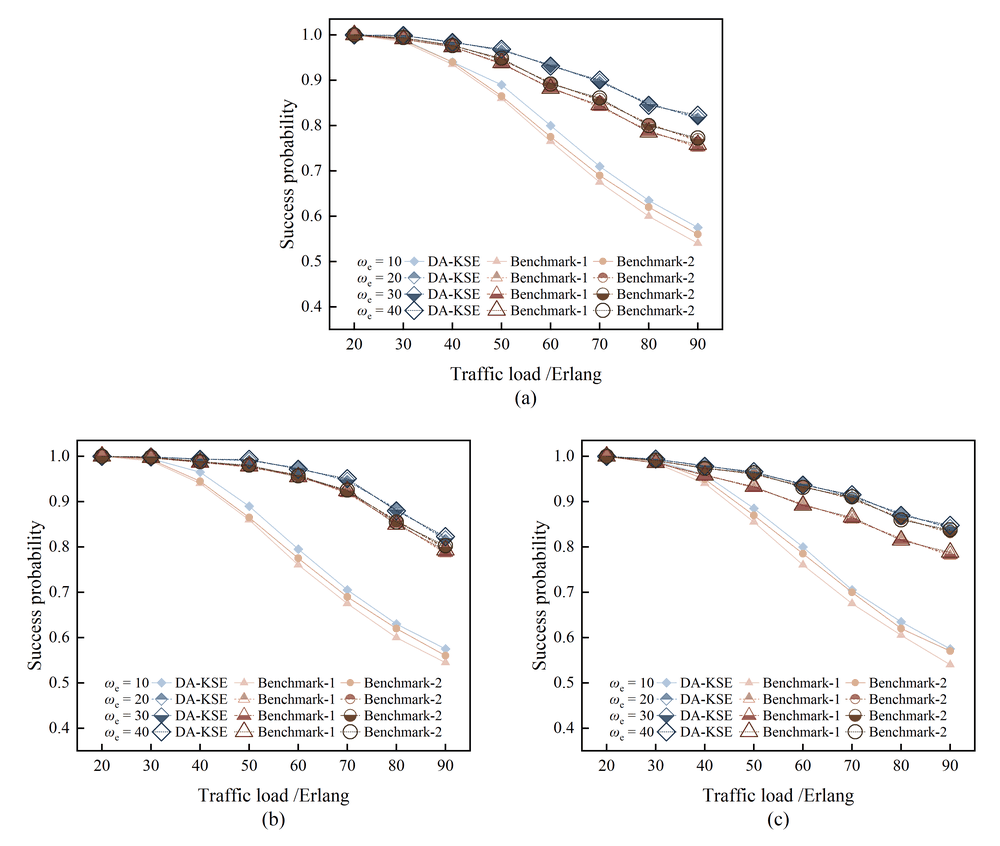
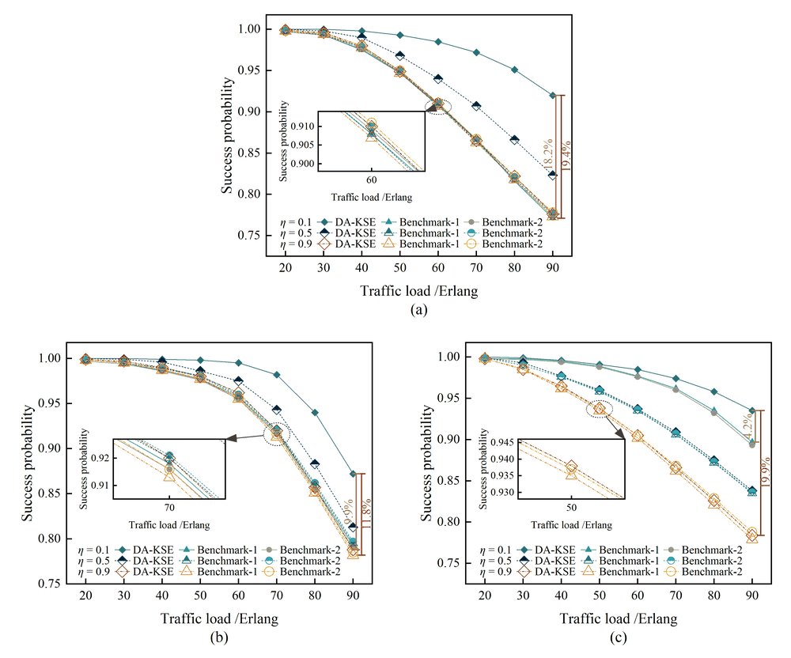
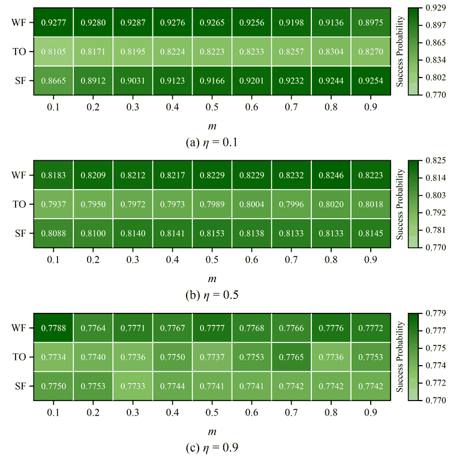
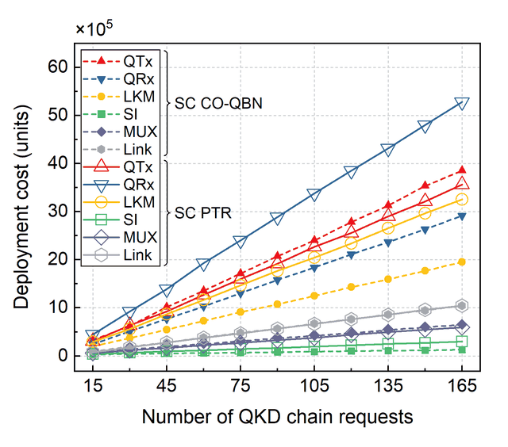
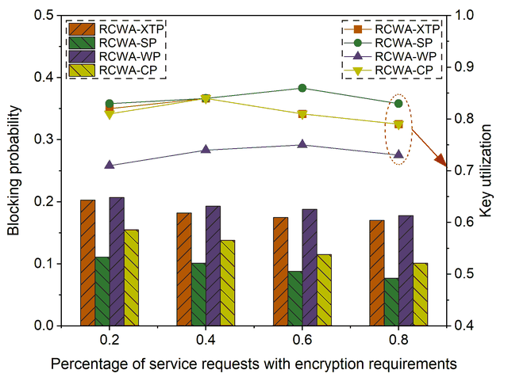
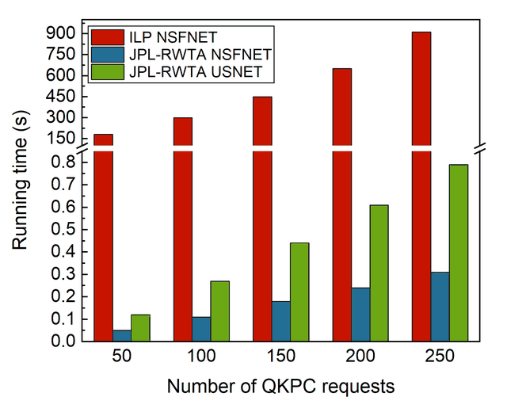
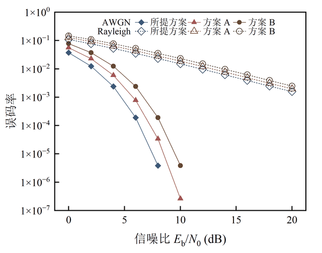
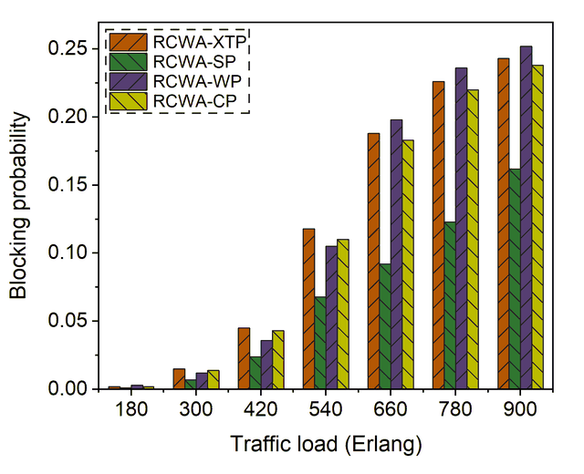

# origin-cli

用本机 Origin（OriginPro）画论文级科研数据图的命令行工具，同时也是一个 Claude Code skill（说明见 [SKILL.md](SKILL.md)）。

写一份 JSON spec，描述数据和每条曲线的语义：name 代表方法，group 代表参数。工具会：
- 在后台启动一个隐藏的 Origin 实例画图；
- 保存可编辑的 `.opju`，方便回到 Origin 里手动精修；
- 导出 PNG / TIF / PDF / EMF / SVG；
- 把诊断信息以 JSON 打印出来，如图例挪了多少、有没有压住数据。

配色、符号形状与填充、符号逐级放大、线型和图例位置，都由学自参考图和期刊文献的规则自动给出。

> **English summary.** origin-cli drives a local OriginLab Origin on Windows from a JSON spec and produces publication-quality figures: line/scatter plots, grouped/stacked/hatched bars, heatmaps with colorbars, dual-axis bar–line combos, error bars, axis breaks, log axes, insets and annotations. It saves an editable `.opju` plus PNG/TIF/PDF/EMF/SVG, and picks colors, markers, line styles and legend placement automatically. It doubles as a Claude Code skill. The documentation is in Chinese.

## 效果

下面的图都由 `examples/` 里的 spec 生成，数据是从参考图上估读的。

| | |
|---|---|
| <br>4 组参数的递进：颜色加深、符号变大变空，图例在框内底部居中 | <br>按参数分色系，局部放大插图，提升百分比括注 |
| <br>三联热力图：格内数值、各自的色标、共用下限 | <br>JSAC 风格：大括号分组的图例、×10ⁿ、网格 |
| <br>柱线双纵轴：花纹柱、左右两个图例、指向右轴的提示 | <br>两种量级的断轴柱状图，两段各自定刻度 |
| <br>中文标题 + 对数轴 | <br>斜线、反斜线交替的花纹柱，虚线框图例 |

## 功能

- **图的类型**：点线 / 散点、柱状（分组、堆叠、重叠、花纹填充）、热力图（带色标）、柱线组合的双纵轴图。
- **坐标与标注**：误差棒、断轴（包括上下两段量级不同的）、对数轴、分类横轴、×10ⁿ 因子、网格、局部放大插图、括注、箭头和文字。
- **排版**：多子图按行排列（如上 1 下 2），可按期刊栏宽（8.5 / 17.5 cm）铺满，子图标题 (a)(b)(c) 自动放置。
- **图例**：每个子图框内一个，可排成矩阵式、列表式或大括号分组式；自动避开曲线和柱子，必要时延长纵轴或换位置。
- **中文**：中文文字自动换成宋体；路径和文件名可以带中文和空格。
- **其他命令**：从 .opju 重新导出、读回格式（`inspect`）、执行 LabTalk、测量参考图、把参考图和成品并排对比。

## 安装

需要：
- Windows
- Origin / OriginPro（在 Origin 2024 上验证过）
- Python ≥ 3.10

```
git clone https://github.com/1naruto-1/origin-cli.git
cd origin-cli
pip install -e .
origin-cli doctor
```

要用 `pip install -e`（可编辑安装）：预设、配色这些数据文件放在仓库目录里，不会随包复制到别处。

`doctor` 会报告找到的 Origin 路径和版本。工具按注册表查找 Origin，装了多个版本时用最新的一个。找不到或想换版本时，在仓库目录建一个 `config.json`：

```json
{"origin_exe": "D:/OriginLab/Origin2024/Origin64.exe"}
```

还可以写 `work_dir`（临时文件目录）和 `startup_timeout`（启动超时，单位秒，默认 60）。

## 快速开始

先跑一个现成的例子：

```
origin-cli build examples/line_omega/spec.json
```

生成的 .opju 和 PNG 在 `examples/line_omega/out/` 下。

自己的数据：把下面的 spec 存成 `spec.json`，和数据文件 `fig5a.csv` 放在一起。CSV 的列是 `load, DA-KSE_10, DA-KSE_20, …`。

```json
{
  "output": "out/fig5",
  "formats": ["png", "pdf"],
  "panels": [
    {"type": "line", "data": "fig5a.csv",
     "x": {"col": "load", "title": "Traffic load /Erlang"},
     "y": {"title": "Success probability"},
     "matrix": {"names": ["DA-KSE", "Benchmark-1"], "groups": [10, 20, 30],
                "col": "{name}_{group}", "label": "\\i(ω)\\-(e) = {group}"}}
  ]
}
```

```
origin-cli build spec.json                          # 出图，诊断打印为 JSON
origin-cli export out/fig5.opju --fmt tif --dpi 600 # 重新导出
origin-cli inspect out/fig5.opju                    # 读回格式
```

形状按 name 分配，颜色深浅、符号大小、填充和线型按 group 递进。spec 的全部字段见 [references/spec.md](references/spec.md)。

## 风格预设

| 预设 | 来源 | 特点 |
|---|---|---|
| `paper`（默认） | `折线图/`、`热力图/` 里的参考图 | Times 字体、刻度朝内、图例底部居中无边框、同色系深浅递进 |
| `jsac` | Cao 等, IEEE JSAC 2021 的 Origin 矢量原图 | Arial、刻度朝内带次刻度、浅灰网格、带框图例放角上、亮色按方法配色、大括号分组的图例、×10ⁿ |

spec 里写 `"preset": "jsac"` 切换。要学一种新风格，在 `presets/` 下新建一个 json，写 `"extends": "paper"`，只列出不同的项。

## 在 Claude Code 里使用

把仓库目录链接到 skills 目录：

```
mklink /J %USERPROFILE%\.claude\skills\origin-cli C:\path\to\origin-cli
```

之后对 Claude 说“用 Origin 把 data.csv 画成点线图”，或输入 `/origin-cli`。agent 会按 [SKILL.md](SKILL.md) 的流程：
1. 理清数据的语义；
2. 写 spec 并出图；
3. 打开 PNG 自查；
4. 告诉你它替你做了哪些决定。

## 文档

| 文件 | 内容 |
|---|---|
| [SKILL.md](SKILL.md) | skill 说明：工作流程、命令、审美规则摘要 |
| [references/spec.md](references/spec.md) | spec 的全部字段和输出格式 |
| [references/style-guide.md](references/style-guide.md) | 审美规则、背后的理由，以及什么时候可以偏离 |
| [references/labtalk.md](references/labtalk.md) | Origin 2024 自动化的坑和已验证的 LabTalk 属性 |

## 目录

| 路径 | 内容 |
|---|---|
| `origin_cli/` | 源代码，各文件分工见下表 |
| `presets/` | 风格预设：字号、框尺寸、线宽、图例参数等 |
| `palettes.json` | 色系、分类配色和热图渐变（色值取自参考图和文献） |
| `references/` | 详细文档 |
| `examples/` | 复刻参考图的完整例子（spec + 数据，部分附原参考图） |
| `折线图/`、`热力图/` | 默认风格学习用的参考图 |
| `tests/` | 单元测试，不需要 Origin |
| `evals/` | skill-creator 的评测用例 |
| `docs/images/` | README 里的效果图 |

`origin_cli/` 里的文件：

| 文件 | 作用 |
|---|---|
| `cli.py` | 命令行入口 |
| `origin.py` | 启动和连接 Origin 会话 |
| `spec.py` | 读取和校验 spec |
| `style.py` | 审美规则 |
| `layout.py` | 排版与图例避让 |
| `draw.py` | 点线图和柱状图的绘制 |
| `heatmap.py` | 热力图 |
| `inspect.py` | 读回 .opju 的格式 |
| `ref.py` | 参考图测量与对比 |
| `fmt.c` | Origin C 辅助函数（必须保存为 UTF-8 带 BOM） |

## 测试

```
python -m pytest tests
```

单元测试覆盖审美分配、坐标范围、排版、图例避让和 spec 校验，不需要 Origin。

画图本身要靠真实的 Origin 验证：build `examples/` 里的 spec，再用 `origin-cli ref compare` 把成品和参考图并排对照。

`evals/evals.json` 是给 skill-creator 用的 6 个评测用例。第 5、6 个要用到文献原文 PDF，仓库里没有附带。

## 已知问题

- **文字上划线**：Origin 2024 以自动化方式启动时，导出图片里的文字上方会多一条横线。工具默认用普通方式隐藏启动来避开它。如果本机已有 Origin 在运行，工具会改用自动化实例，并在输出里提示：关掉 Origin 后用 `export` 重新导出即可。
- **build 要一个接一个跑**：每次 build 都会启动一个 Origin，并行时实例之间会互相干扰。
- **箭头**：插图的指示箭头是直线，不是弧线。
- **花纹密度**：Origin 内置花纹最密的一档，仍比部分文献原图稀。
- **暂不支持**：面积图、饼图、三维图。

## 致谢

默认风格学自 `折线图/`、`热力图/` 里的参考图。其他规则和例子学自以下论文中的数据图，论文原文不包含在仓库里：

- Cao 等, “Hybrid Trusted/Untrusted Relay-Based Quantum Key Distribution Over Optical Backbone Networks”, IEEE JSAC, 2021：`jsac` 预设、大括号分组图例、×10ⁿ
- Yu 等, “Routing, Core, and Wavelength Allocation in Multi-Core-Fiber-Based Quantum-Key-Distribution-Enabled Optical Networks”, IEEE Access, 2021：花纹柱、柱线双纵轴
- Cao 等, “Time-Scheduled Quantum Key Distribution (QKD) Over WDM Networks”, JLT, 2018：两种量级的断轴柱状图
- “Multicast-oriented key provision in hybrid DV/CV multi-domain quantum networks”, Chinese Physics B, 2025：重叠柱、点线图断轴

## 许可证

[MIT](LICENSE)
